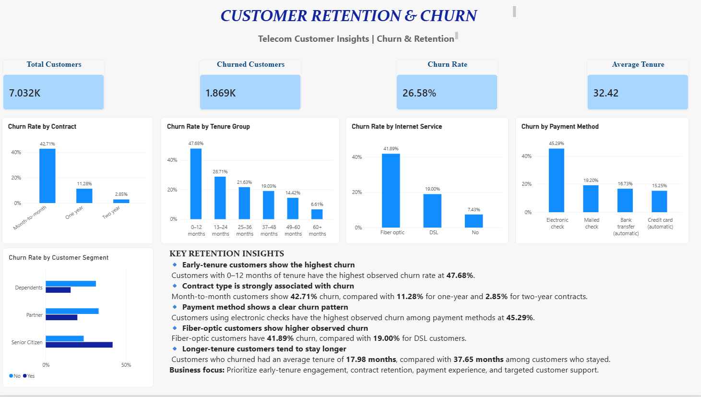

# Customer Retention & Churn Analysis

## Project Overview

This project was completed as part of the **Future Interns Data Science & Analytics Internship – Task 2**.

The project analyzes telecom customer data to understand customer churn and retention patterns. The analysis focuses on identifying customer groups associated with higher churn, examining customer tenure patterns, and presenting actionable retention insights through an interactive Power BI dashboard.

---

## Objective

The main objectives of this project are to:

- Calculate the overall customer churn rate
- Analyze churn across different contract types
- Examine churn patterns based on customer tenure
- Analyze churn by internet service and payment method
- Compare churn across customer segments
- Understand differences in tenure between retained and churned customers
- Identify important patterns associated with customer churn
- Present findings through an interactive Power BI dashboard
- Suggest practical actions that may support customer retention

---

## Dataset

The project uses the **Telco Customer Churn** dataset.

Each row represents a customer and contains information related to:

- Customer demographics
- Account information
- Contract type
- Tenure
- Internet service
- Payment method
- Monthly charges
- Total charges
- Churn status

The original dataset contained customer-level subscription information used to analyze retention and churn patterns.

---

## Tools & Technologies

- **Python**
- **Pandas**
- **Jupyter Notebook**
- **Microsoft Power BI**
- **DAX**
- **Git & GitHub**

---

## Data Preparation

The dataset was loaded and analyzed using Python and Pandas.

The main data preparation steps included:

- Loading the CSV dataset
- Inspecting dataset dimensions and column data types
- Checking for missing values
- Checking for duplicate records
- Converting `TotalCharges` to numeric format
- Handling invalid or blank `TotalCharges` values
- Removing records with missing `TotalCharges`
- Creating tenure groups for churn analysis
- Saving the cleaned dataset for dashboard development

The cleaned dataset was then used for Power BI analysis.

---

## Exploratory Data Analysis

The analysis examined churn patterns across several customer characteristics.

### Overall Churn

The Power BI dashboard shows:

- **Total Customers:** 7,032
- **Churned Customers:** 1,869
- **Churn Rate:** 26.58%
- **Average Tenure:** 32.42 months

### Churn by Contract Type

Observed churn rates:

| Contract Type | Churn Rate |
|---|---:|
| Month-to-month | 42.71% |
| One year | 11.28% |
| Two year | 2.85% |

### Churn by Tenure

| Tenure Group | Churn Rate |
|---|---:|
| 0–12 months | 47.68% |
| 13–24 months | 28.71% |
| 25–36 months | 21.63% |
| 37–48 months | 19.03% |
| 49–60 months | 14.42% |
| 60+ months | 6.61% |

### Churn by Internet Service

| Internet Service | Churn Rate |
|---|---:|
| Fiber optic | 41.89% |
| DSL | 19.00% |
| No internet service | 7.43% |

### Churn by Payment Method

| Payment Method | Churn Rate |
|---|---:|
| Electronic check | 45.29% |
| Mailed check | 19.20% |
| Bank transfer (automatic) | 16.73% |
| Credit card (automatic) | 15.25% |

### Customer Segment Analysis

Observed churn patterns across selected customer segments included:

| Segment | Group | Churn Rate |
|---|---|---:|
| Senior Citizen | No | 23.65% |
| Senior Citizen | Yes | 41.68% |
| Partner | No | 32.98% |
| Partner | Yes | 19.72% |
| Dependents | No | 31.28% |
| Dependents | Yes | 15.53% |

---

## Key Insights

### 1. Early-tenure customers show higher observed churn

Customers with **0–12 months of tenure** have the highest observed churn rate at **47.68%**. Churn decreases across the longer-tenure groups.

### 2. Contract type is strongly associated with churn

Month-to-month customers show a **42.71%** churn rate, compared with **11.28%** for one-year contracts and **2.85%** for two-year contracts.

### 3. Electronic check customers show higher observed churn

Customers using electronic checks have an observed churn rate of **45.29%**, the highest among the payment methods analyzed.

### 4. Fiber-optic customers show higher observed churn

The observed churn rate for fiber-optic customers is **41.89%**, compared with **19.00%** for DSL customers and **7.43%** for customers without internet service.

### 5. Churned customers have shorter average tenure

Customers who churned had an average tenure of approximately **17.98 months**, compared with **37.65 months** among customers who stayed.

### 6. Customer segments show different churn patterns

Senior citizens, customers without partners, and customers without dependents show higher observed churn rates within the analyzed segments.

> **Note:** These findings describe associations observed in the dataset. They do not by themselves establish that a particular characteristic directly causes customer churn.

---

## Retention Recommendations

Based on the observed churn patterns, the following business actions can be considered:

- Strengthen onboarding and engagement during the first year of customer tenure.
- Develop retention strategies for month-to-month customers.
- Monitor customers showing early signs of disengagement.
- Review the payment experience for electronic-check customers.
- Investigate customer experience and service issues among fiber-optic customers.
- Use customer segmentation to support targeted retention campaigns.
- Monitor churn trends regularly through an interactive dashboard.

---

## Power BI Dashboard

The interactive Power BI dashboard provides:

- Total customer KPI
- Churned customer KPI
- Overall churn rate KPI
- Average tenure KPI
- Churn rate by contract
- Churn rate by tenure group
- Churn rate by internet service
- Churn rate by payment method
- Customer segment churn analysis
- Key retention insights

### Dashboard Preview



---

## Project Structure

```text
FUTURE_DS_02/
│
├── data/
│   ├── Telco-Customer-Churn.csv
│   └── Telco-Customer-Churn-Cleaned.csv
│
├── notebooks/
│   └── 01_churn_analysis.ipynb
│
├── dashboard/
│   └── FUTURE_DS_02_Customer_Retention_Churn.pbix
│
├── screenshots/
│   └── business_retention_churn_dashboard.png
│
└── README.md